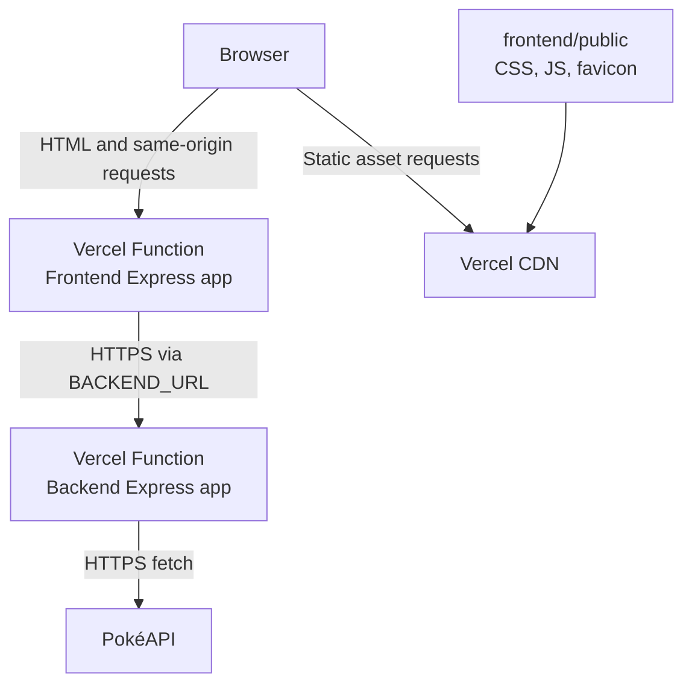

# Architecture

## 1. System overview

The application is split into two independently deployable Node.js/Express applications:

- **Frontend** (`frontend/`): serves HTML pages rendered with Express Handlebars, exposes same-origin API proxy endpoints for browser requests, applies API rate limiting, and serves local static assets during development.
- **Backend** (`backend/`): exposes a JSON API, validates request parameters and external PokéAPI payloads, coordinates outbound requests, maps upstream data into application view models, and maintains in-memory caches.

The external data provider is the PokéAPI (`https://pokeapi.co/api/v2/`).

In local development, the frontend listens on port `4000` and calls the backend at `http://127.0.0.1:3000` by default. In production, each directory is configured as the Root Directory of its own Vercel project. The frontend calls the backend's deployed HTTPS URL through `BACKEND_URL`.

## 2. Deployment topology

The two Vercel projects use the same source repository but different Root Directories:

| Vercel project | Root Directory | Express entrypoint | Static files |
|---|---|---|---|
| `pokemon-backend` | `backend` | `app.js` | None |
| `pokemon-frontend` | `frontend` | `app.js` | `public/**` |

The frontend and backend use separate environment modules containing only the settings each application consumes. The frontend reads `BACKEND_URL`, `FRONTEND_PORT`, and `TRUST_PROXY_HOPS`; the backend reads `PORT` and the catalogue cache settings. This keeps runtime imports within each Vercel project Root Directory and prevents irrelevant settings from being parsed by the other application. The root `.env` file is only a convenient input for the local development scripts.

Vercel detects the Express `app.js` entrypoint and runs the exported Express application as a Vercel Function. These are Node.js Functions, not Edge Runtime functions. The `vercel.json` in each project sets a 30-second function duration, subject to the account plan's platform limits.

## 3. Frontend request lifecycle

### 3.1 Initial catalogue page

1. The browser requests `/` or `/?page=N`.
2. The frontend route parses the page number with `parsePage`.
3. `getOffsetForPage` converts the page to an offset using the page size of 50.
4. The frontend creates `limit` and `offset` query parameters with `URLSearchParams`.
5. The frontend calls the backend at `${BACKEND_URL}/pokemons?...` with a 10-second request timeout.
6. The backend returns a JSON object containing `count` and card results.
7. The frontend calculates pagination metadata and renders `home.handlebars` using Express Handlebars.
8. The browser receives complete HTML. The client JavaScript enhances search and pagination interactions.

### 3.2 Search and pagination from the browser

The browser requests the frontend's same-origin routes:

- `/api/pokemons`
- `/api/pokemons/search?q=...`

The frontend applies `express-rate-limit` to these proxy routes, validates/normalizes the query parameters it forwards, calls the backend using `BACKEND_URL`, and relays the backend's status and JSON response.

The frontend's same-origin proxy avoids requiring browser-side cross-origin API access or exposing a separate backend URL in client JavaScript.

### 3.3 Pokémon detail page

1. The browser requests `/pokemons/:id`.
2. The frontend calls `${BACKEND_URL}/pokemons/:id` with a 10-second timeout.
3. Backend validation and service logic retrieve the Pokémon and species description from PokéAPI.
4. The frontend renders `pokemon.handlebars` with the returned detail view model.
5. Invalid or missing Pokémon IDs are presented using the not-found page behavior.

## 4. Backend layers

The backend follows a layered structure:

- **Routes** (`backend/src/routes/`): map HTTP paths to controller methods.
- **Controllers** (`backend/src/controllers/`): validate request query/path parameters with Zod schemas and translate results into HTTP responses.
- **Services** (`backend/src/services/`): coordinate cache lookup, single-flight behavior, upstream requests, validation, and mapping.
- **Clients** (`backend/src/clients/`): construct safe PokéAPI URLs, issue HTTP requests with a 10-second timeout, reject redirects, and convert unsuccessful upstream responses into application errors.
- **Schemas** (`backend/src/schemas/`): validate request parameters and external payload shapes.
- **Mappers** (`backend/src/mappers/`): convert external API payloads into the card and detail structures consumed by the frontend.
- **Caches** (`backend/src/cache/`): hold catalogue pages and the Pokémon list in process memory.
- **Error middleware** (`backend/src/middlewares/`): map known application and body-parser errors to JSON responses and handle unexpected failures.

## 5. Static assets

The frontend's static files are stored in `frontend/public/`:

- `css/styles.css`
- `javascript/app.js`
- `javascript/async.js`
- `javascript/fouc.js`
- `icons/favicon.svg`

When the Vercel frontend project uses `frontend` as its Root Directory, `frontend/public/` is the `public/` directory at the root of that deployed project. Vercel serves these files through its static delivery network/CDN.

The Express `express.static()` middleware is retained for local development. It is not the mechanism Vercel uses to serve deployed static assets.

## 6. Environment and service communication

The frontend uses `BACKEND_URL` as the base URL for backend HTTP requests. The value must be the backend deployment's base HTTPS URL, without a path suffix. The environment parser validates that the URL uses HTTP or HTTPS and strips trailing slashes.

Backend cache behavior is controlled by:

- `POKEMON_LIST_CACHE_KEY`
- `CACHE_FRESH_TTL_MS`
- `CACHE_STALE_TTL_MS`

Frontend proxy trust behavior is controlled by `TRUST_PROXY_HOPS`, which configures Express's `trust proxy` setting. The deployed value must be checked against the actual proxy chain so rate limiting uses client IPs correctly.

## 7. Serverless runtime characteristics

Each Vercel project runs as a Function. A Function instance can be reused for multiple requests, but instances may be created, suspended, replaced, or scaled independently.

Consequences for this implementation:

- The `Map` cache, `node-cache` instance, and `singleFlight` in-flight map are local to an individual backend process/instance.
- The default `express-rate-limit` memory store is local to an individual frontend process/instance.
- Cache contents and rate-limit counters are not globally consistent across instances or regions.
- Background stale refreshes are asynchronous and best-effort; the implementation does not use a durable queue or an explicit serverless background-task primitive.
- The application does not use the Vercel Edge Runtime. Express and its Node.js dependencies run in Node.js Functions.

These characteristics are acceptable for the current lightweight application, but a shared Redis-compatible cache/rate-limit store or durable background processing would be needed if globally consistent behavior becomes a requirement.

## 8. Rendering model

The HTML pages are rendered on the server with Express Handlebars. The frontend fetches data before calling `res.render`, so the initial HTML includes Pokémon content.

The browser then loads the JavaScript module in `frontend/public/javascript/app.js` to add client-side interactions. This is progressive enhancement, not framework hydration: there is no React/Vue component tree or serialized framework state being rehydrated.
