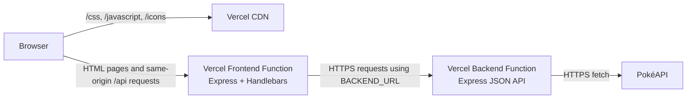
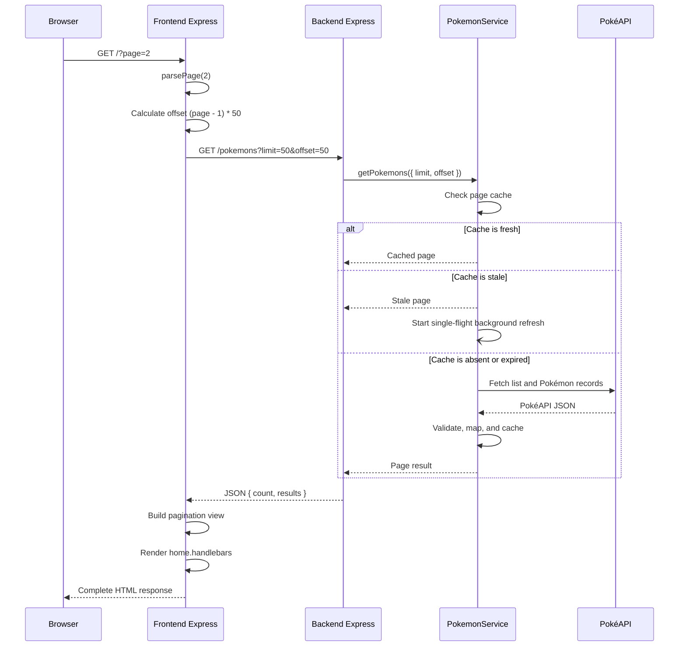
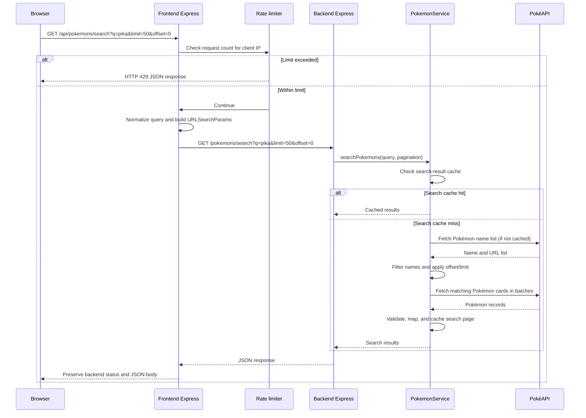
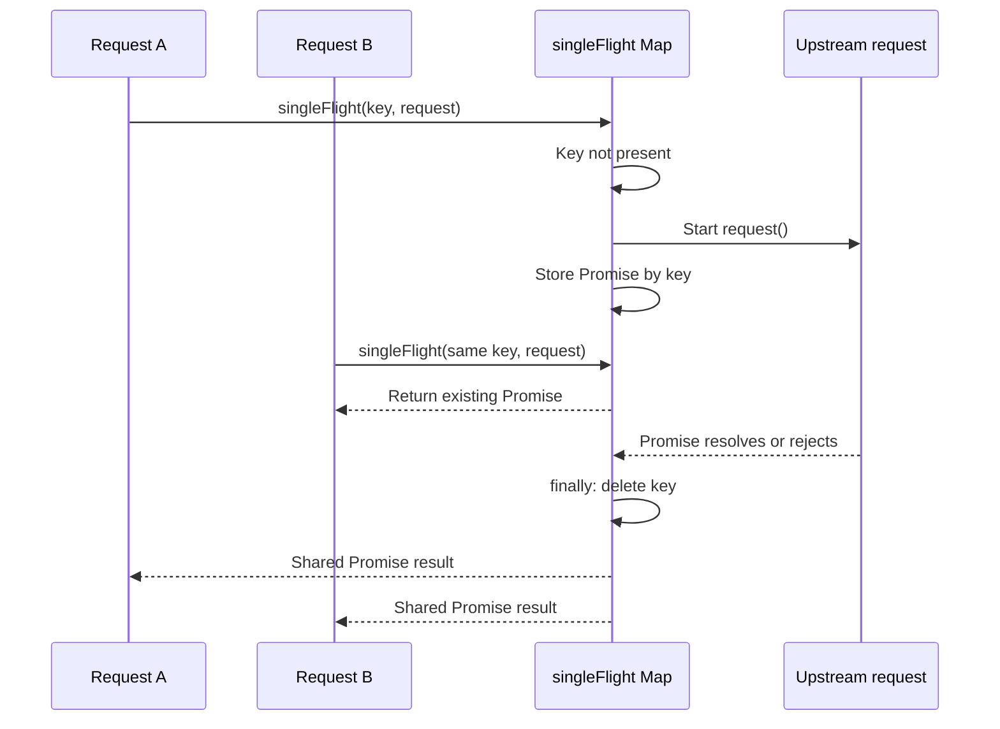
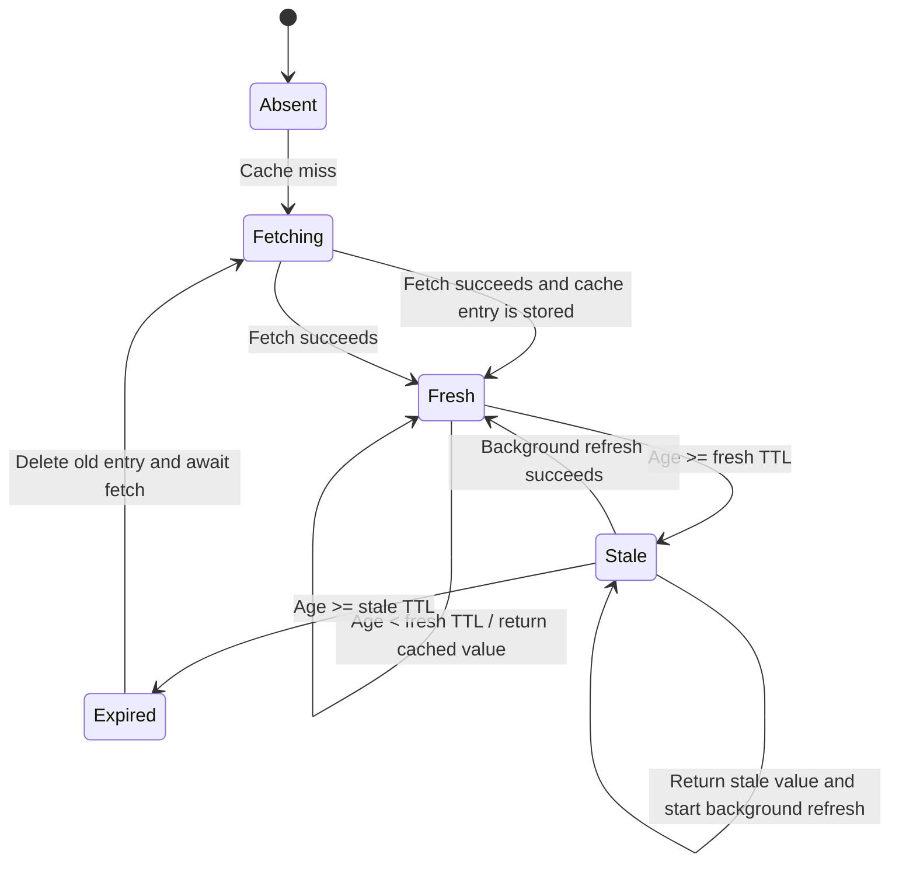
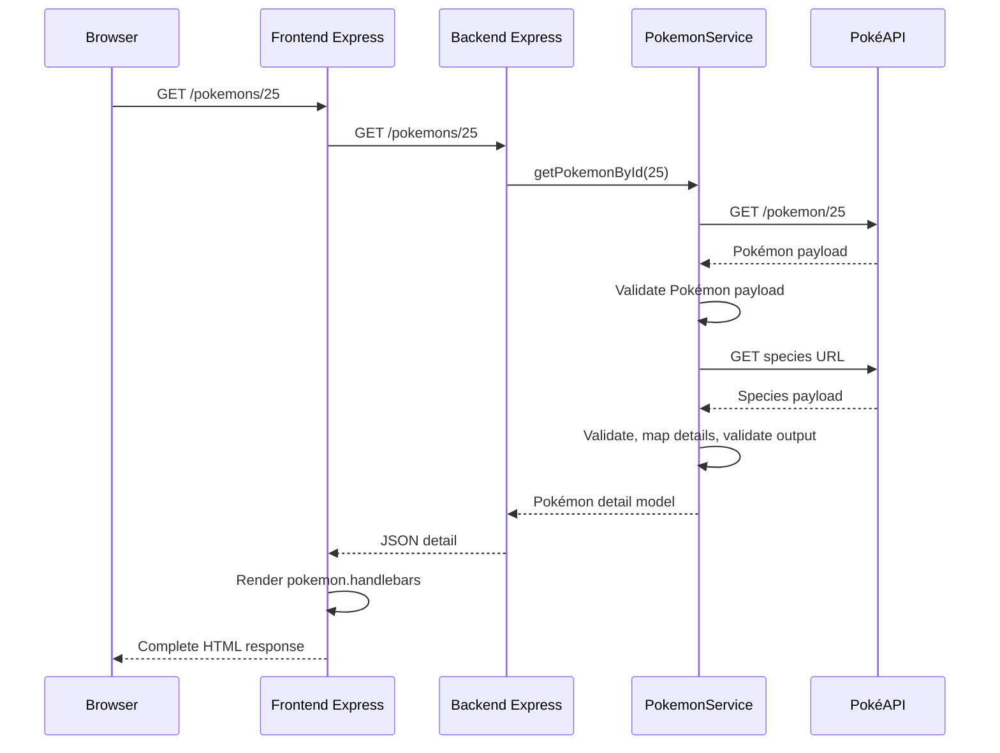

# Diagrams

The diagrams below describe the current implementation and its Vercel deployment topology.

## 1. Deployment architecture

## 2. Server-rendered catalogue request

## 3. Browser search request through the frontend proxy

## 4. Single-flight lifecycle

## 5. Cache state transitions

The state machine is process-local. A new Vercel Function instance starts with an empty in-memory cache.

## 6. Pokémon detail page

